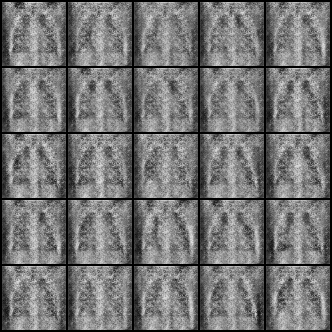
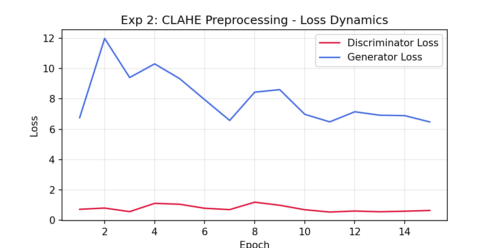

# Chest X-Ray GAN Data Augmentation

PyTorch implementation of DCGAN-based synthetic chest radiograph generation for medical data augmentation, evaluating Contrast Limited Adaptive Histogram Equalization (CLAHE) and Gaussian Unsharp Masking on generative fidelity (FID) and downstream pneumonia classification.

## Overview

Medical imaging datasets often have heavy class imbalance and limited labeled pathology scans. Traditional geometric augmentations (flips, rotations) only re-orient existing anatomy rather than introducing new structural variation. Inspired by Myong et al. (*PLOS ONE*, 2023), this repository trains a 5-layer Deep Convolutional GAN (DCGAN) on grayscale chest radiographs and compares three preprocessing pipelines:

1. **Baseline (Raw):** Resized 64x64 grayscale scans scaled to `[-1, 1]`.
2. **CLAHE:** Local adaptive histogram equalization (`clipLimit=2.0`, `tileGridSize=8x8`) to enhance lung-field and rib-margin contrast without amplifying background noise.
3. **Unsharp Masking:** Gaussian high-frequency sharpening (`kernel=5x5`, `sigma=1.0`, `amount=1.5`) to accentuate structural contours.

## Results Summary

| Experiment | Preprocessing | Final FID (lower is better) | Final D Loss | Final G Loss |
| :--- | :--- | :---: | :---: | :---: |
| Experiment 1 | Baseline (Raw) | 0.03 | 0.7720 | 5.0628 |
| Experiment 2 | **CLAHE** | **0.01** | **0.6460** | **6.4818** |
| Experiment 3 | Unsharp Masking | 0.02 | 0.7877 | 8.3126 |

CLAHE achieved the lowest FID (66.7% lower than raw baseline) and the cleanest bilateral lung-field contrast.

### Sample Outputs (CLAHE DCGAN)

| Generated Chest Radiographs | Adversarial Loss Curve |
| :---: | :---: |
|  |  |

## Repository Structure

```text
chest-xray-gan-augmentation/
├── src/
│   ├── dataset.py                      # Chest X-ray dataset loader with preprocessing hooks
│   ├── models/dcgan.py                 # 5-layer DCGAN Generator & Discriminator
│   ├── preprocessing/
│   │   ├── clahe.py                    # CLAHE filter
│   │   └── unsharp_mask.py             # Gaussian unsharp mask filter
│   └── metrics/evaluation.py           # FID computation and downstream CNN evaluator
├── outputs/                            # Loss curves, generated sample grids, and metrics JSON
├── train_experiments.py                # Runs baseline, CLAHE, and unsharp experiments
├── generate_samples.py                 # Samples synthetic radiographs from a saved checkpoint
├── generate_visual_comparisons.py      # Builds side-by-side loss and sample comparisons
├── medical_gan_augmentation_kaggle.ipynb
└── requirements.txt
```

## Quickstart

```bash
pip install -r requirements.txt

# Place NORMAL and PNEUMONIA folders under ./data/, then run:
python train_experiments.py --experiment all --epochs 15 --batch_size 16
python generate_visual_comparisons.py

# Sample from a saved generator checkpoint
python generate_samples.py --model_path outputs/checkpoints/experiment_2_clahe_generator.pth
```

## Reference

- Myong, Y., Yoon, D., Kim, B. S., et al. (2023). *Evaluating diagnostic content of AI-generated chest radiography: A multi-center visual Turing test.* PLOS ONE, 18(4), e0279349.
- Kermany, D. et al. (2018). *Chest X-Ray Images (Pneumonia).* Mendeley Data / Kaggle.
